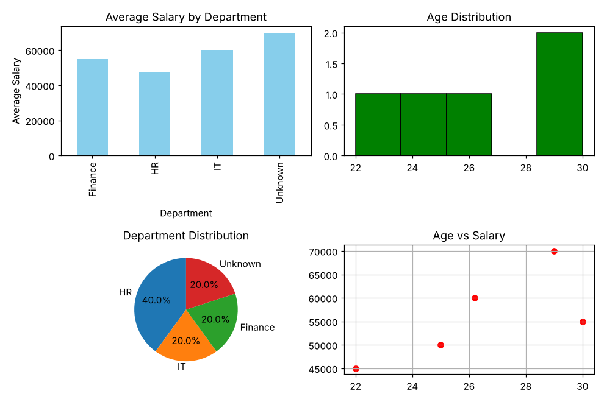
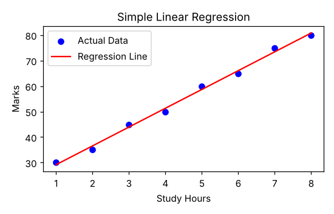

# Machine Learning using Python - Practicals

Ten practicals covering NumPy, Pandas, Matplotlib and Scikit-learn.

## Setup

```bash
pip install -r requirements.txt
```

Run any practical with, for example:

```bash
python practical_03_simple_linear_regression.py
```

## Practicals

| # | File | Aim |
|---|------|-----|
| 1 | [practical_01_numpy_pandas.py](practical_01_numpy_pandas.py) | NumPy array operations and Pandas dataset exploration (create, filter, sort, update, save/read CSV). |
| 2 | [practical_02_data_cleaning_visualization.py](practical_02_data_cleaning_visualization.py) | Data cleaning (missing values, duplicates) and visualization with Pandas and Matplotlib. |
| 3 | [practical_03_simple_linear_regression.py](practical_03_simple_linear_regression.py) | Simple Linear Regression: predict Marks from Study Hours. |
| 4 | [practical_04_multiple_linear_regression.py](practical_04_multiple_linear_regression.py) | Multiple Linear Regression: predict Marks from Study Hours and Attendance. |
| 5 | [practical_05_knn_classification.py](practical_05_knn_classification.py) | Classification using K-Nearest Neighbours (K = 3). |
| 6 | [practical_06_decision_tree_evaluation.py](practical_06_decision_tree_evaluation.py) | Decision Tree classification with Confusion Matrix and Classification Report. |
| 7 | [practical_07_kmeans_clustering.py](practical_07_kmeans_clustering.py) | K-Means clustering on Age and Income. |
| 8 | [practical_08_hierarchical_clustering_pca.py](practical_08_hierarchical_clustering_pca.py) | Hierarchical (Agglomerative) clustering and PCA. |
| 9 | [practical_09_healthcare_random_forest.py](practical_09_healthcare_random_forest.py) | Mini project: healthcare disease prediction using Random Forest. |
| 10 | [practical_10_ml_pipeline.py](practical_10_ml_pipeline.py) | End-to-end ML pipeline (StandardScaler + Random Forest) for student performance prediction. |

## Sample outputs

### Practical 1: NumPy array operations and Pandas dataset exploration (create, filter, sort, update, save/read CSV).

```text
[10 20 30 40 50]
Shape: (5,) | Dimensions: 1 | Size: 5
Sum = 150 | Mean = 30.0 | Max = 50 | Min = 10 | Std = 14.142135623730951
Transpose:
 [[1 4 7]
 [2 5 8]
 [3 6 9]]
Sum: 45 | Mean: 5.0
0    85
1    90
2    78
3    92
4    88
dtype: int64
    Name  Age  Marks        City
0  Rahul   20     85        Pune
1  Priya   21     92      Mumbai
2   Amit   20     78      Nashik
3  Sneha   22     95      Nagpur
4  Karan   21     88  Aurangabad
Shape: (5, 4)
Columns: ['Name', 'Age', 'Marks', 'City']
            Age      Marks
count   5.00000   5.000000
mean   20.80000  87.600000
std     0.83666   6.580274
min    20.00000  78.000000
25%    20.00000  85.000000
50%    21.00000  88.000000
75%    21.00000  92.000000
max    22.00000  95.000000
Missing values:
 Name     0
Age      0
Marks    0
City     0
dtype: int64
Unique values:
 Name     5
Age      3
Marks    5
City     5
dtype: int64
    Name  Marks
0  Rahul     85
1  Priya     92
2   Amit     78
3  Sneha     95
4  Karan     88
    Name  Age  Marks        City
0  Rahul   20     85        Pune
1  Priya   21     92      Mumbai
3  Sneha   22     95      Nagpur
4  Karan   21     88  Aurangabad
    Name  Age  Marks        City
1  Priya   21     92      Mumbai
4  Karan   21     88  Aurangabad
    Name  Age  Marks        City
3  Sneha   22     95      Nagpur
1  Priya   21     92      Mumbai
4  Karan   21     88  Aurangabad
0  Rahul   20     85        Pune
2   Amit   20     78      Nashik
    Name  Age  Marks        City             Result Grade
0  Rahul   20     85        Pune               Pass     B
1  Priya   21     92      Mumbai               Pass     A
2   Amit   20     78      Nashik  Needs Improvement     C
3  Sneha   22     95      Nagpur               Pass    A+
4  Karan   21     88  Aurangabad               Pass     A
Average Marks = 87.6
Max = 95 | Min = 78
City
Pune          1
Mumbai        1
Nashik        1
Nagpur        1
Aurangabad    1
Name: count, dtype: int64
    Name  Age  Marks        City             Result Grade
0  Rahul   20     85        Pune               Pass     B
1  Priya   21     92      Mumbai               Pass     A
2   Amit   20     78      Nashik  Needs Improvement     C
3  Sneha   22     95      Nagpur               Pass    A+
4  Karan   21     88  Aurangabad               Pass     A
```

### Practical 2: Data cleaning (missing values, duplicates) and visualization with Pandas and Matplotlib.

```text
    Name   Age   Salary Department
0   John  25.0  50000.0         HR
1  Alice   NaN  60000.0         IT
2    Bob  30.0      NaN    Finance
3  David  22.0  45000.0         HR
4   Emma  29.0  70000.0        NaN
5   John  25.0  50000.0         HR
Name          0
Age           1
Salary        1
Department    1
dtype: int64
    Name   Age   Salary Department
0   John  25.0  50000.0         HR
1  Alice  26.2  60000.0         IT
2    Bob  30.0  55000.0    Finance
3  David  22.0  45000.0         HR
4   Emma  29.0  70000.0    Unknown
Name              str
Age           float64
Salary        float64
Department        str
dtype: object
```



### Practical 3: Simple Linear Regression: predict Marks from Study Hours.

```text
Slope: 7.380952380952383
Intercept: 21.785714285714278
Predicted Marks: [29.17 36.55 43.93 51.31 58.69 66.07 73.45 80.83]
Predicted Marks for 9 Study Hours: 88.21428571428572
```



### Practical 4: Multiple Linear Regression: predict Marks from Study Hours and Attendance.

```text
   Study_Hours  Attendance  Marks
0            2          60     35
1            3          65     42
2            4          70     48
3            5          75     55
4            6          80     63
5            7          85     70
6            8          90     78
7            9          95     85
Coefficients:
Study Hours = 0.27655677655677635
Attendance = 1.3827838827838825
Intercept = -49.18681318681317
Predicted Marks: [34.33 41.52 48.71 55.9  63.1  70.29 77.48 84.67]
Predicted Marks for Study Hours = 10 and Attendance = 96: 86.32600732600733
```

### Practical 5: Classification using K-Nearest Neighbours (K = 3).

```text
   Study_Hours  Attendance Result
0            1          55   Fail
1            2          60   Fail
2            3          65   Fail
3            4          70   Pass
4            5          75   Pass
5            6          80   Pass
6            7          85   Pass
7            8          90   Pass
Prediction for Study Hours = 5 and Attendance = 78: Pass
```

### Practical 6: Decision Tree classification with Confusion Matrix and Classification Report.

```text
   Study_Hours  Attendance Result
0            1          55   Fail
1            2          60   Fail
2            3          65   Fail
3            4          70   Pass
4            5          75   Pass
5            6          80   Pass
6            7          85   Pass
7            8          90   Pass
Predicted Result: ['Fail' 'Fail' 'Fail' 'Pass' 'Pass' 'Pass' 'Pass' 'Pass']
Confusion Matrix:
[[3 0]
 [0 5]]
Classification Report:
              precision    recall  f1-score   support

        Fail       1.00      1.00      1.00         3
        Pass       1.00      1.00      1.00         5

    accuracy                           1.00         8
   macro avg       1.00      1.00      1.00         8
weighted avg       1.00      1.00      1.00         8
```

### Practical 7: K-Means clustering on Age and Income.

```text
Clustered Data:
   Age  Income  Cluster
0   22   25000        0
1   25   28000        0
2   23   26000        0
3   45   65000        1
4   46   68000        1
5   48   70000        1
6   30   40000        0
7   32   42000        0
Cluster Centers:
[[2.64000000e+01 3.22000000e+04]
 [4.63333333e+01 6.76666667e+04]]
```

### Practical 8: Hierarchical (Agglomerative) clustering and PCA.

```text
Hierarchical Clustering Result:
   Age  Income  Cluster
0   22   25000        0
1   25   28000        0
2   23   26000        0
3   45   65000        1
4   46   68000        1
5   48   70000        1
6   30   40000        0
7   32   42000        0
Principal Component:
[[-20500.]
 [-17500.]
 [-19500.]
 [ 19500.]
 [ 22500.]
 [ 24500.]
 [ -5500.]
 [ -3500.]]
Explained Variance Ratio: [1.]
```

### Practical 9: Mini project: healthcare disease prediction using Random Forest.

```text
   Age   BP  Sugar Disease
0   25  120     90      No
1   30  130     95      No
2   35  125    100      No
3   40  140    110     Yes
4   45  145    120     Yes
5   50  150    130     Yes
6   55  155    140     Yes
7   60  160    150     Yes
Predicted Disease Status: ['No' 'No' 'No' 'Yes' 'Yes' 'Yes' 'Yes' 'Yes']
Accuracy: 1.0
              precision    recall  f1-score   support

          No       1.00      1.00      1.00         3
         Yes       1.00      1.00      1.00         5

    accuracy                           1.00         8
   macro avg       1.00      1.00      1.00         8
weighted avg       1.00      1.00      1.00         8

Prediction for New Patient: Yes
```

### Practical 10: End-to-end ML pipeline (StandardScaler + Random Forest) for student performance prediction.

```text
   Study_Hours  Attendance  Assignments Result
0            2          60            1   Fail
1            3          65            2   Fail
2            4          70            2   Fail
3            5          75            3   Pass
4            6          80            3   Pass
5            7          85            4   Pass
6            8          90            4   Pass
7            9          95            5   Pass
8            5          72            3   Fail
9            6          88            4   Pass
Actual Result: ['Fail', 'Fail']
Predicted Result: ['Pass', 'Fail']
Accuracy: 0.5
              precision    recall  f1-score   support

        Fail       1.00      0.50      0.67         2
        Pass       0.00      0.00      0.00         0

    accuracy                           0.50         2
   macro avg       0.50      0.25      0.33         2
weighted avg       1.00      0.50      0.67         2

Prediction for New Student: Pass
```

> Note: outputs were generated with Python 3.12, scikit-learn 1.9, pandas 3.0 and NumPy 2.5. Results may vary slightly by version. Practical 10 uses a tiny 10-row dataset, so its 2-sample test accuracy is naturally unstable.
